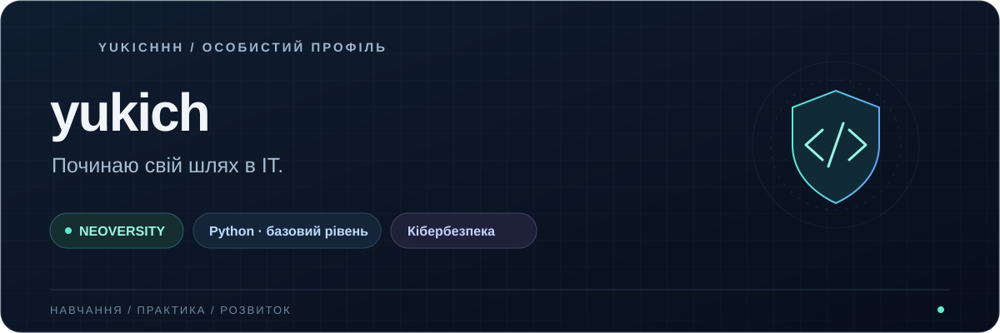

  

  <strong>Learning. Practicing. Working toward cybersecurity.</strong>

### Hi, I'm yukich 👋

I'm a **NEOVERSITY** student and a beginner in programming. I have **basic Python knowledge** and want to build a solid foundation for a career in tech. I'm interested in **cybersecurity** and hope to become a specialist in this field.

 

| 🎓 Education | 🐍 Skills | 🛡️ Interest |
| :--- | :--- | :--- |
| Studying at **NEOVERSITY** | **Python · beginner** | **Cybersecurity** |

### My learning goals

- Improve my Python skills and understanding of programming fundamentals.
- Gain hands-on experience through learning projects.
- Explore cybersecurity step by step.

### A little about me

I adapt quickly to new situations. In my free time, I play **Dota 2** with friends and hang out on **Discord**.

### Learning project

**[NEOVERSITY Team ↗](https://github.com/Agnasikc/Test/tree/yukich-profile)**

My introduction on our team website, including my goals and plans after graduation.

---

> Live a life you can be proud of.
